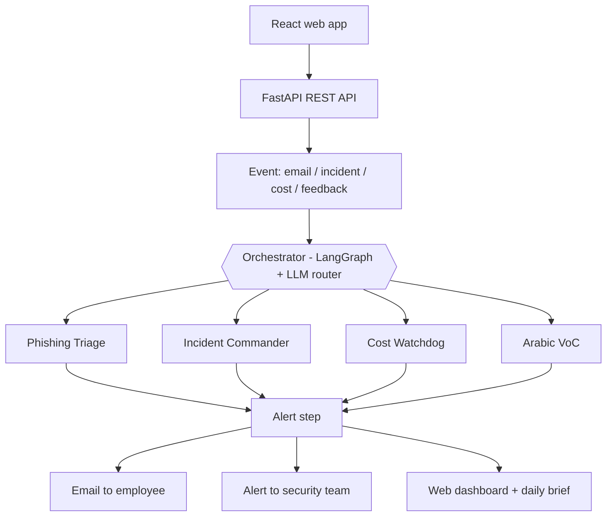

# Sentinel: Project Story, Architecture and Roadmap

## 1. The idea

Companies face four risks every day: **phishing**, **system outages**, **wasted cloud/AI money**, and
**unhappy customers**. Each needs different data and expertise, so one AI agent can't do it all well.

**Sentinel** is a **multi-agent system**: an Orchestrator sends every event to a specialist agent.
The agent collects evidence, an LLM explains it, and Sentinel sends alerts and a daily brief automatically.

## 2. How it matches the Final Project brief

| Objective | In Sentinel |
| --- | --- |
| 1. Data Retrieval | Real emails, real server logs, real LLM traffic, live model prices (web API), real Arabic reviews, company policy (RAG), SQLite memory |
| 2. Processing & Summarization | Checks collect evidence, the LLM writes the summary |
| 3. Automated Actions | Reply to employee, alert email, daily brief, web dashboard (React) |
| 4. Workflow Orchestration | LangGraph routes each event to the right agent |
| 5. Presentation | Notebook + this document + demo video |
| 6. Testing & Evaluation | 38 automated tests + measured on 700 real emails (90% detection, 0.6% false alarms) and 4,272 real reviews |

## 3. Architecture



Why FastAPI + React and not only Streamlit: the agents are a real service with a REST API
(`/docs` lists every endpoint), so any app (web, mobile, Slack bot) can use them. The React app is one client of that API.

## 4. How an LLM agent thinks (example: Phishing)

```
email (.eml)
  1. Read        -> sender, reply-to, SPF/DKIM/DMARC, links, attachments           (email_reader.py)
  2. Investigate -> the LLM CHOOSES tools: inspect_sender, check_link, scan_wording,
                    ask_ml_model, sender_history (memory), search_policy (RAG)       (phishing_agent.py, llm.py)
  3. Decide      -> structured answer: verdict, confidence, summary, reply          (Pydantic)
  4. Guardrail   -> the rule checks run on the real email: 6+ points or a prompt
                    injection can never end as safe                                 (checks.py)
  5. Act         -> reply to the employee, alert the team, risky actions wait for a human (reporter.py)
```
The other agents work the same way with their own tools: log tools + runbook (Incident), calculator tools + cost policy
(Cost), read/count Arabic reviews (VoC).

## 5. Build order (= the notebook steps)

| Step | Question | File |
| --- | --- | --- |
| 1 | What does a raw email look like? | – |
| 2 | Where do settings live? | `config.py` |
| 3 | How do we read an email? | `email_reader.py` |
| 4 | Is my old ML model enough alone? | – |
| 5 | Which checks reveal phishing? | `checks.py` |
| 6 | How does Sentinel remember? | `memory.py` |
| 7 | How do we decide and add the LLM? | `llm.py`, `knowledge.py`, `results.py`, `phishing_agent.py` |
| 8 | How do people get the results? | `reporter.py` |
| 9 | Agent 2: is a server under attack? (real logs) | `incident_agent.py` |
| 10 | Agent 3: are we wasting money on AI? (real LLM traffic) | `cost_agent.py` |
| 11 | Agent 4: what do customers complain about? (real Arabic reviews) | `voc_agent.py` |
| 12 | How do the agents connect? | `orchestrator.py` |
| 13 | How good is it on real data? | `evaluation.py` |

## 5b. The four agents

| Agent | Data it reads | What it finds | Who gets the alert |
| --- | --- | --- | --- |
| Phishing Triage | Reported email (.eml): 200 real phishing + 500 real normal | Fake domains, fake links, AI-injection, dangerous files, bait | Security team + the employee |
| Incident Commander | Real SSH + Apache logs (Loghub) | Brute-force attacks, guessed usernames, error storms | On-call engineer |
| Cost Watchdog | 28,000 real LLM requests (Azure) + live prices (LiteLLM) | Over budget, big model on small task, costly long prompts | CTO |
| Arabic VoC | 4,272 real Arabic reviews (souq.com) | Top complaints, customers who say "don't buy" | Product manager |

### Still to do
- [x] Incident Commander
- [x] Cost Watchdog
- [x] Arabic VoC
- [x] Real data for every agent (`datasets/README.md`)
- [x] Professional web app: FastAPI REST API + React (9 pages)
- [x] Gemini API key in `.env` and a run with the real LLM
- [ ] Deploy + demo video + LinkedIn post

## 6. Key decisions

1. **Multi-agent:** each agent has one job, its own checks and its own tests.
2. **Points, not magic:** every verdict is explained by reasons with points a human can check.
3. **The LLM can't be tricked into "safe":** the email is treated as data, AI-injection gives +3 points,
   and the LLM can only make the verdict stricter.
4. **Humans approve risky actions:** blocking a domain or deleting emails needs a click.
5. **Works offline:** with no API key it still runs on checks + the ML model.
